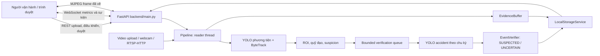

# Kiến trúc và pipeline ATADS

- **Ngày khảo sát:** 2026-10-15 (Asia/Bangkok)
- **Phạm vi:** Đọc route FastAPI, frontend tĩnh, xử lý nguồn và pipeline nhận diện/track/xác minh.
- **Giới hạn:** Luồng được xác nhận bằng mã nguồn và một integration test với video tổng hợp cùng fake models. Chưa chạy toàn bộ ứng dụng qua trình duyệt trong phiên khảo sát này.

## Kiến trúc thực tế

Đây là ứng dụng web cục bộ: frontend HTML/CSS/JavaScript thuần được `backend/main.py` phục vụ; backend FastAPI chạy qua Uvicorn. `frontend/js/app.js` dùng REST cho upload, điều khiển pipeline, config, sự kiện và status; WebSocket `/api/ws` nhận sự kiện/verification; `` đọc MJPEG `/api/pipeline/stream`. BAT khởi chạy Uvicorn với host `127.0.0.1`, port mặc định `8765`.

## Pipeline frame và event

1. `/api/videos/upload` nhận định dạng video cho phép, giới hạn kích thước từ rules, ghi vào thư mục upload với ID do server sinh, tính SHA-256 và xác nhận OpenCV mở được file.
2. `/api/pipeline/start` chọn `source_type=video` (ID upload) hoặc `source_type=camera`. Camera source có thể là index `0..16` hoặc URL RTSP/RTSPS/HTTP/HTTPS.
3. `Pipeline.start` kiểm tra nguồn, reset tracker/trạng thái rồi tạo reader thread. Video dùng `cv2.VideoCapture(path)`. Webcam dùng DirectShow nếu có; URL dùng FFmpeg. Camera đặt buffer size 1; nếu đọc thất bại thì chuyển pipeline sang ERROR/STOPPED, không có cơ chế reconnect tự động.
4. Mỗi frame chạy `ModelManager.vehicle_track`, filter detections theo tâm bbox nếu ROI bật, cập nhật trajectory và chạy `SuspicionAnalyzer`.
5. Sự kiện bắt đầu khi trigger duy trì đủ số frame. Pipeline lưu metadata JSON và ảnh tại chỗ, tạo `EventVerifier` riêng, bắt đầu buffer clip trước/sau.
6. Trong lúc event còn hoạt động, model accident được gọi theo `verification_interval_seconds` (mặc định fallback 0.5 giây nếu config thiếu khóa); tác vụ đi qua queue bounded. Khi queue đầy, queue loại bỏ task cũ nhất để ưu tiên quan sát mới và tăng `dropped`.
7. `EventVerifier` đánh giá mẫu trong cửa sổ thời gian và trạng thái chỉ là SUSPECTED hoặc UNCERTAIN. Người vận hành mới có thể cập nhật CONFIRMED/REJECTED. UNCERTAIN đóng event tự động; nó không có nghĩa model xác nhận tai nạn.
8. `_draw` vẽ bbox, track ID, quỹ đạo, hướng và ROI lên frame, encode JPEG cho stream.

## File và điểm vào chính

| File / vị trí | Thành phần | Vai trò |
|---|---|---|
| `backend/main.py:57` | `lifespan` | Đọc settings, tạo storage/log/upload, nạp models, dựng Pipeline |
| `backend/main.py:125` | `/api/videos/upload` | Nhận video, kiểm loại/kích thước/decode |
| `backend/main.py:212` | `/api/pipeline/start` | Điều phối nguồn video/camera |
| `backend/main.py:298` | `/api/pipeline/stream` | MJPEG |
| `backend/main.py:315` | `/api/ws` | Kênh cập nhật WebSocket |
| `backend/core/pipeline.py:25` | `BoundedWorker` | Queue tác vụ inference accident, xử lý quá tải |
| `backend/core/pipeline.py:147` | `Pipeline.start` | Kiểm nguồn, reset, khởi động reader |
| `backend/core/pipeline.py:191`, `:198`, `:216` | `_read_video`, `_read_camera`, `_capture_loop` | Mở nguồn và đọc frame |
| `backend/core/pipeline.py:265` | `_process` | Inference phương tiện, ROI, trajectory, suspicion, queue, render và metric |
| `backend/core/pipeline.py:366` | `_draw` | Vẽ kết quả trên frame |
| `backend/core/pipeline.py:426` | `_run_verification` | Model accident, verifier, ghi event |
| `backend/detection/models.py:17` | `ModelManager` | Hai YOLO models và inference |
| `backend/analysis/suspicion.py:17` | `SuspicionAnalyzer` | Candidate trigger |
| `backend/analysis/event_verifier.py:14` | `EventVerifier` | Bằng chứng thời gian, không kết luận cuối |

## Tốc độ và ý nghĩa của metrics

`_process` đo khoảng cách giữa thời điểm bắt đầu xử lý gần đây để cập nhật `output_fps`/`processing_fps`; giá trị latency là elapsed từ đầu `_process` tới sau inference phương tiện, thao tác event, vẽ và JPEG encode. Thời gian inference của từng model được lưu riêng. Những số này không đo toàn bộ thời gian camera exposure/transport, buffering driver/network, queue/render browser và hiển thị màn hình. Vì thế không gọi `output_fps` hiện tại là FPS render của trình duyệt hay end-to-end latency.

`queue_size` và `dropped_verifications` liên quan đến tác vụ accident-verification, không phải bộ đếm frame nguồn bị loại. Video file được pace theo FPS metadata và tốc độ phát; xử lý chậm hơn nguồn có thể làm thực tế kéo dài hoặc drop nhịp deadline, còn camera xử lý tuần tự với buffer nhỏ.

## Điều chưa xác minh và hạn chế từ mã

- Không xác minh bằng phiên browser/app hoàn chỉnh trong khảo sát này. Kiểm tra socket tới backend cục bộ bị sandbox chặn quyền truy cập; điều đó không chứng minh backend hỏng.
- Webcam DirectShow đã được probe riêng trong phiên làm việc trước trên máy này và đọc được frame ở index 1; đây không phải kiểm thử app/pipeline/model tích hợp cho thời lượng dài.
- Không có reconnect camera khi `capture.read()` thất bại; pipeline chuyển lỗi và dừng.
- Full endpoint `/api/pipeline/stream`, RTSP, codec đầu ra bằng chứng, reconnect, tải dài và shutdown chưa chạy thử.
- Một queue nhỏ giúp chặn tích tụ tác vụ xác minh, nhưng bỏ task cũ có thể giảm số quan sát accident; cần đo `dropped_verifications` khi phát video dài.
